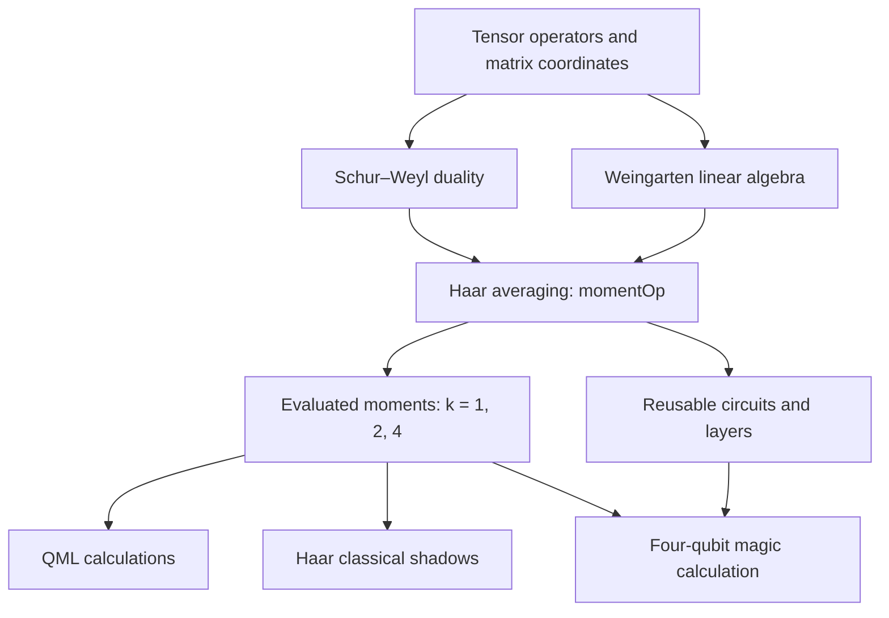
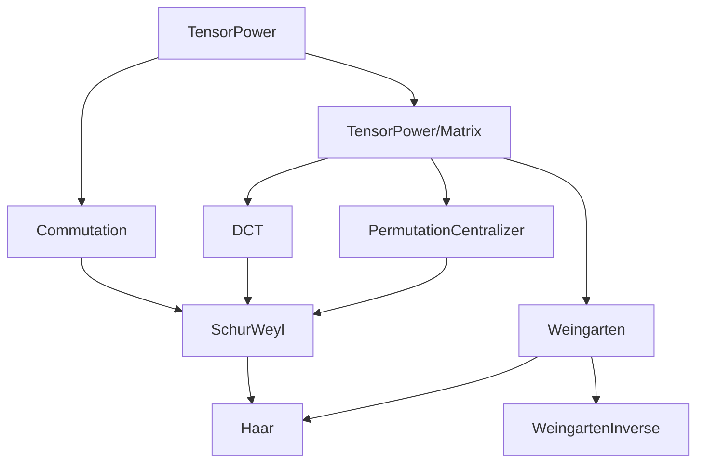
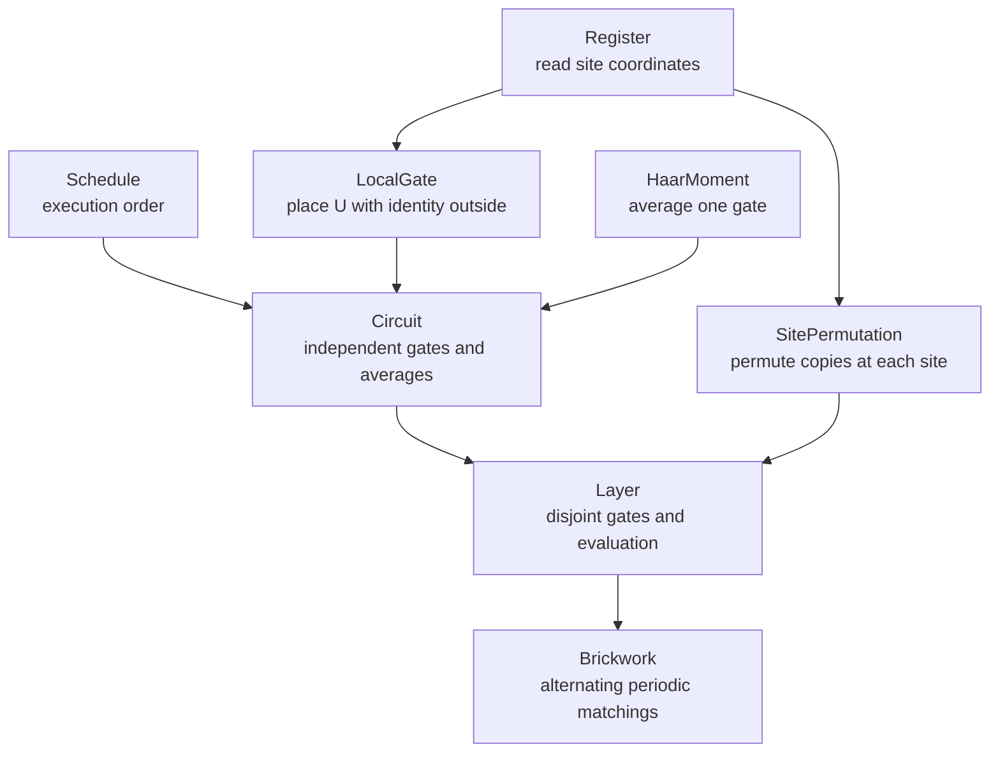
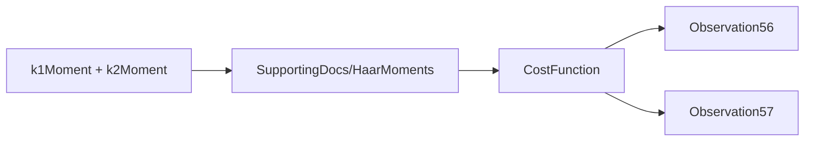
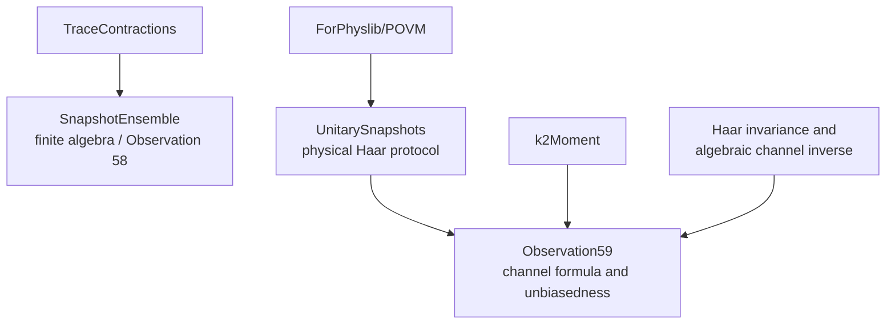
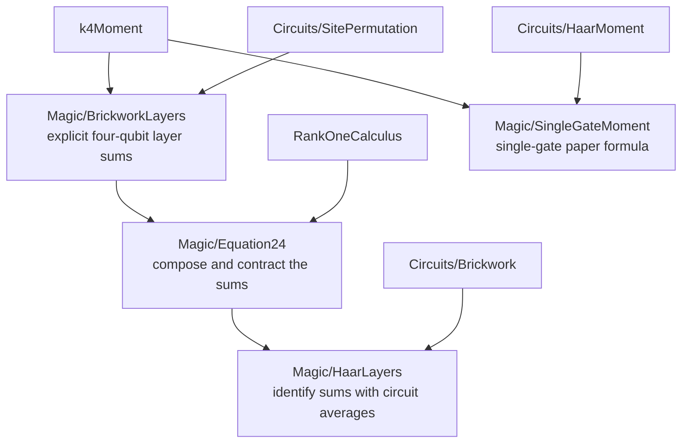

# LeanHaar module map

Current working-tree structure, 2026-11-13: **42 library modules**, plus the library
umbrella and test suite. The library has three jobs: prove the Haar integration
formula, make it usable for random circuits, and apply it to concrete calculations.

Read the overview first, then the section for the calculation you care about.
Arrows point **from a provider to a consumer**. The diagrams show selected mathematical
dependencies, including indirect ones; they are not exhaustive import graphs.
Every current module has a row below, with its purpose and reason for being present.

## The overall picture

The shared tensor, trace and integration tools support these paths. Mathlib supplies
the underlying algebra and analysis throughout. Physlib supplies states and POVMs
for the physical shadow model and quantum objects used by some standalone examples.

| Part | Owns | Boundary |
| --- | --- | --- |
| Core: `LeanHaar/` and `TensorPower/` | Tensor actions, centralizers, Gram systems and the actual Haar integral. | No application or circuit definitions. |
| `Moments/` | Evaluations of the core integral at specific copy numbers. | Coefficients and formulas, independent of application protocols. |
| `SupportingDocs/` | Shared tensor identities, trace contractions, integration facts and algebraic channels. | No application imports. This folder contains tools both below and above computed moments. |
| `Circuits/` | Registers, placed gates, independent circuits, disjoint layers and brickwork. | General parameters; no four-qubit paper notation. |
| `Applications/` | Protocols, observables and paper-specific formulas. | Uses shared results to establish the intended calculation. |
| `ForPhyslib/` | Local additions to Physlib's existing POVM API. | Depends on Physlib, not LeanHaar mathematics. |
| `Examples/` | Three independent demonstrations. | Not steps in the maintained Haar/application proof chain. |

## Core mathematics

The duality proof and the Gram-system construction are separate ingredients.
`Haar` brings them together for the genuine integral. `WeingartenInverse` adds
coefficient uniqueness in the range `k ≤ d`; general solvability does not need that bound.
Here, the diagonal action means applying the same arbitrary map to every tensor factor.

| Module | What it does | Why it is needed / where it is used |
| --- | --- | --- |
| [TensorPower](../LeanHaar/TensorPower.lean) | Defines `TensV`, factor permutations (`permAction`, `permOp`) and tensor powers of maps (`diagAction`). | Supplies the operators used throughout the library. Optional GL/unitary wrappers remain commented out. |
| [TensorPower/Matrix](../LeanHaar/TensorPower/Matrix.lean) | Defines the tensor basis and `toEndMatrix`; computes action entries. | Gives centralizer proofs, integration and vectorization a common coordinate system. |
| [Commutation](../LeanHaar/Commutation.lean) | Proves permutations commute with applying the same map to every tensor factor. | Supplies the easy inclusions in the centralizer equalities and trace identities. |
| [PermutationCentralizer](../LeanHaar/PermutationCentralizer.lean) | Proves monomial coefficient independence, then identifies operators commuting with permutations as combinations of diagonal tensor actions. | Provides the polynomial half of duality for all `d,k`. Includes the former `PolyIndep` theorem under its unchanged public name. |
| [DCT](../LeanHaar/DCT.lean) | Proves the permutation algebra equals its double centralizer using Mathlib's semisimplicity and density results. | Turns the polynomial centralizer result into the opposite centralizer equality. Representation adapters stay private. |
| [SchurWeyl](../LeanHaar/SchurWeyl.lean) | Assembles `centralizer(diagImage) = span(permImage)`. | Identifies the possible invariant operators. It proves this equality, not a decomposition into irreducible representations. |
| [Weingarten](../LeanHaar/Weingarten.lean) | Defines vectorization and the trace/Gram system; proves a solution exists by orthogonal projection. | Supplies the algebraic coefficients and trace characterization later used by `Haar`. It does not define a Haar integral. |
| [WeingartenInverse](../LeanHaar/WeingartenInverse.lean) | Provides vectorization equivalences, Gram invertibility and unique inverse-Gram coefficients when `k ≤ d`. | Used by `k4Moment` and the general circuit moment formula. No pseudoinverse formula is supplied for the singular range. |
| [Haar](../LeanHaar/Haar.lean) | Defines `haarProb`, `actOn` and the entrywise integral `momentOp`; proves invariance and its permutation decomposition. | Connects the algebraic calculation to actual Haar averaging. Also contains the argument upgrading unitary commutation to the condition needed by duality. |

## Evaluated moments and shared support

`k` counts copies and `d` is the dimension being averaged. These modules evaluate
the existing `momentOp`; they do not introduce different Haar measures.

| Module | What it does | Why it is needed / where it is used |
| --- | --- | --- |
| [Moments/k1Moment](../LeanHaar/Moments/k1Moment.lean) | Proves the first-moment trace-over-dimension formula, with `[NeZero d]`. | Supplies scalar means in shared `HaarMoments`, hence QML. |
| [Moments/k2Moment](../LeanHaar/Moments/k2Moment.lean) | Evaluates the second moment as identity and swap terms, for `d ≥ 2`. | Supplies QML square moments and the actual shadow-channel calculation in Observation 59. |
| [Moments/k4Moment](../LeanHaar/Moments/k4Moment.lean) | Verifies the explicit fourth-order Weingarten coefficients and formula, for `4 ≤ d`. | Supplies the weights of the magic calculation, including two-qubit gates with `d = 4`. |

The eight support modules have distinct mathematical roles. In particular,
`TensorPowerBasics` and `Swap` help prove computed moments, while `HaarMoments`
uses those computed moments. Treating the entire folder as one dependency layer
would hide this distinction.

| Module in `SupportingDocs` | What it does | Why it is needed / where it is used |
| --- | --- | --- |
| [TensorPowerBasics](../LeanHaar/SupportingDocs/TensorPowerBasics.lean) | Permutation composition, identity traces, vectorization entries and Hilbert–Schmidt/matrix identities. | Shared by moment calculations, swap theory and site permutations. Contains the former `Vectorization` lemmas. |
| [Swap](../LeanHaar/SupportingDocs/Swap.lean) | Defines the two-factor swap and proves its entries, composition and traces. | Keeps the two-copy theory used by `k2Moment` and tensor trace calculations together. |
| [TensorPowerTraces](../LeanHaar/SupportingDocs/TensorPowerTraces.lean) | Matrix tensor products, conjugation, tensor traces and contraction of identity/swap combinations. | Converts core operators into the matrix calculations used by Haar averages and shadows. It imports `Haar`, but no evaluated moment formula. |
| [HaarInvariance](../LeanHaar/SupportingDocs/HaarInvariance.lean) | Haar regularity, right/inverse invariance and integration of continuous group actions. | Justifies changes of Haar variables and the projection laws used by circuits, QML and shadows. |
| [HaarMoments](../LeanHaar/SupportingDocs/HaarMoments.lean) | Trace/integral interchange, evaluated first/second matrix averages and squared-commutator averages. | Is the direct reusable input to QML. Uses `k1Moment`, `k2Moment`, trace calculus and Haar invariance. |
| [RankOneCalculus](../LeanHaar/SupportingDocs/RankOneCalculus.lean) | Composes finite sums of rank-one operators and collects their kernel coefficients. | Turns MagicMonotone's layer sums into Equation 24; the theorem is general inner-product-space algebra. |
| [TraceContractions](../LeanHaar/SupportingDocs/TraceContractions.lean) | Bundled trace contractions on formal tensors of endomorphisms. | Expresses Observation 58's finite second/third tensor identities. Its carrier differs from the operators on `TensV` in `TensorPowerTraces`. |
| [DepolarizingChannel](../LeanHaar/SupportingDocs/DepolarizingChannel.lean) | An algebraic trace-plus-identity linear map and its inverse/equivalence. | Supplies inverse laws after Observation 59 evaluates the Haar channel. It is not a bundled CPTP channel. |

## Reusable circuit machinery

There are eight circuit files after consolidation. Three questions determine the structure:
**where does a gate act, how do independent gates compose, and how is a layer evaluated?**

| Module in `Circuits` | What it does | Why it is needed / where it is used |
| --- | --- | --- |
| [Register](../LeanHaar/Circuits/Register.lean) | Converts a register index into site digits and regroups copies/sites. | Gives placement and site permutations the same convention: site zero is the least significant digit. |
| [LocalGate](../LeanHaar/Circuits/LocalGate.lean) | Constructs tensor products and places a gate on an ordered embedding `Fin s ↪ Fin n`; proves its entry formula. | Builds the sampled physical circuit, preserving identity on untouched sites. Contains the former `UnitaryTensor` construction and laws. |
| [Schedule](../LeanHaar/Circuits/Schedule.lean) | Defines chronological products and their append/grouping rules for any monoid. | Makes multiplication order explicit without importing probability: `[A,B]` evaluates to `B * A`. |
| [HaarMoment](../LeanHaar/Circuits/HaarMoment.lean) | Defines the vectorized conjugation action and global/placed gate averages; relates them to `momentOp`. | Supplies one-gate projection laws and the general inverse-Gram rank-one formula (`k ≤ d`). `operatorMap` returns to ordinary operators. |
| [Circuit](../LeanHaar/Circuits/Circuit.lean) | Defines sampled circuits and products of gate moments; proves equality to their independent-sample integral. | Makes composition of averages a proved statement about the physical ensemble. Contains the former `IndependentMoments` factorization theorem. |
| [SitePermutation](../LeanHaar/Circuits/SitePermutation.lean) | Builds site-wise copy permutations and factors their Hilbert–Schmidt overlaps into local Gram entries. | Supplies the permutation operators needed to evaluate layers. These are copy permutations, not sampled physical gates. |
| [Layer](../LeanHaar/Circuits/Layer.lean) | Proves disjoint-gate commutation and reordering, and self-adjointness of their Haar moment; evaluates covering layers by Weingarten sums. | Shares the layer argument across geometries. Evaluation requires disjoint blocks covering the register and `k ≤ q ^ s`. The disjointness laws do not require coverage or that bound. |
| [Brickwork](../LeanHaar/Circuits/Brickwork.lean) | Defines odd/even periodic matchings and schedules of literal matching-layer depth; specializes the layer results. | Provides the reusable alternating-layer circuit consumed by MagicMonotone and other register sizes. |

`Circuit` proves independence factorization without assuming the operators commute.
`Layer` then adds the stronger laws that follow from disjoint supports. These are
different results. Reusing a gate location at two times still gives two independent samples.

The physical circuit applying A then B has unitary `B * A`. Generic circuit moments
use Schrödinger conjugation; the magic calculation uses the corresponding Heisenberg
action and hence the adjoint moment. The relation is proved, not handled by changing
the schedule convention.

## Applications and their connection to Haar

### QML

| Module in `Applications/QML` | What it does | Why it is needed / connection |
| --- | --- | --- |
| [CostFunction](../LeanHaar/Applications/QML/CostFunction.lean) | Defines the cost and gradient expression and specializes shared Haar formulas to the cost. | Supplies the application vocabulary and moments used by both observations. |
| [Observation56](../LeanHaar/Applications/QML/Observation56.lean) | Specializes to qubit dimensions and a traceless observable. | Records the paper's cost mean and square-moment-difference formulas. |
| [Observation57](../LeanHaar/Applications/QML/Observation57.lean) | Computes nested independent Haar averages of the gradient expression. | Records the paper's gradient mean and square-moment-difference formulas. |

The gradient is a defined expression; differentiation is not formalized here.
The variance-labelled results use ordinary complex squares, so the real-valued
probabilistic interpretation is additional work.

### Classical shadows

| Module in `Applications/ClassicalShadows` | What it does | Why it is needed / connection |
| --- | --- | --- |
| [SnapshotEnsemble](../LeanHaar/Applications/ClassicalShadows/SnapshotEnsemble.lean) | Finite weighted measurement-channel algebra and Observation 58's tensor-contraction identities. | Preserves the paper's finite identities. Despite the filename, there is no `SnapshotEnsemble` structure; weights and snapshots are explicit arguments. |
| [UnitarySnapshots](../LeanHaar/Applications/ClassicalShadows/UnitarySnapshots.lean) | Defines recorded projectors, the Haar measurement channel and `haarShadow`; identifies trace weights with Physlib Born probabilities. | Specifies the actual experiment and connects its snapshots to the core conjugation orbit before evaluating a moment. |
| [Observation59](../LeanHaar/Applications/ClassicalShadows/Observation59.lean) | Uses `k2_moment` to evaluate the actual Haar channel, prove its inverse laws and show reconstruction is unbiased. | Completes the Born-weighted Haar result for physical states when `d ≥ 2`. |

There is intentionally no arrow from Observation 58's finite tensor model to the Haar
proof: no formal identification between these two models is asserted. The finite
identities alone do not require positive normalized probabilities. The physical Haar
branch uses Physlib's `POVM.measure` and density states.

### Magic monotone calculation

| Module in `Applications/MagicMonotone` | What it does | Why it is needed / connection |
| --- | --- | --- |
| [SingleGateMoment](../LeanHaar/Applications/MagicMonotone/SingleGateMoment.lean) | States the explicit fourth-moment ket-bra formula and identifies it with Haar averaging for `4 ≤ d`. | Connects the paper's single-gate notation to the general library. It is not an intermediate dependency of the current layer proof. |
| [BrickworkLayers](../LeanHaar/Applications/MagicMonotone/BrickworkLayers.lean) | Specializes site permutations to four qubits; defines the explicit A/B sums and evaluates overlaps. | Supplies the paper's concrete operators and coefficients using shared site-permutation and fourth-moment results. |
| [Equation24](../LeanHaar/Applications/MagicMonotone/Equation24.lean) | Composes the explicit layer sums and collects the interlayer kernel. | Applies general rank-one calculus to establish the paper's algebraic equations. |
| [HaarLayers](../LeanHaar/Applications/MagicMonotone/HaarLayers.lean) | Specializes shared circuit results to prove that these sums average four independent two-qubit Haar gates. | Gives the algebraic equations their physical Haar meaning, for arbitrary input operators, with the Heisenberg order preserved. |

`Circuits/Brickwork` owns general geometry and averaging. `MagicMonotone/BrickworkLayers`
owns the explicit four-qubit formulas. Their connection is a theorem in `HaarLayers`,
not a second implementation of random-circuit averaging. The final scalar magic
monotone has not yet been evaluated.

## Physlib extensions, examples and checks

| Module | What it does | Why it is kept |
| --- | --- | --- |
| [ForPhyslib/POVM](../LeanHaar/ForPhyslib/POVM.lean) | Extends Physlib's existing POVM with unitary-basis measurement and its Born trace formula. | Shared physical measurement support for `UnitarySnapshots`; intended for Physlib, but not yet upstream. |
| [Examples/UnitaryCommutant](../LeanHaar/Examples/UnitaryCommutant.lean) | Proves the two-dimensional unitary commutant result through an irreducible representation. | Retains a distinct elementary Schur-lemma example; not used by core `SchurWeyl`. |
| [Examples/PauliTwirling](../LeanHaar/Examples/PauliTwirling.lean) | Computes a finite Pauli average of a Bloch-form matrix. | Retains the standalone finite-twirling example. It is neither the Haar theorem nor a Pauli-shadow protocol. |
| [Examples/EulerAngleIntegral](../LeanHaar/Examples/EulerAngleIntegral.lean) | Evaluates an unnormalized sine-weighted coordinate integral. | Retains the explicit integration example. Its measure is not proved equal to `haarProb`. |
| [LeanHaar.lean](../LeanHaar.lean) | Imports all 42 library modules. | Provides a complete import and lets CI check module coverage. |
| [test/LeanHaarTest/Axioms](../test/LeanHaarTest/Axioms.lean) | Checks the reported axioms of the main theorem endpoints. | Guards their trusted assumptions; CI additionally audits every library/test declaration. |
| [test/LeanHaarTest/Circuits](../test/LeanHaarTest/Circuits.lean) | Tests conventions, gate placement, independent samples, layer laws and the four-qubit connection. | Checks the circuit user interface and its semantics. |
| [test/LeanHaarTest.lean](../test/LeanHaarTest.lean) | Imports the configured test modules. | Gives `lake test` and the test axiom audit a complete root. |

## File boundaries after cleanup

The polynomial coefficient lemma now lives in `PermutationCentralizer`; its global
name `monomial_coeff_zero_of_eval_zero` is preserved for the blueprint. `PolyIndep` is
removed. The preceding consolidation removed two files without changing theorems: `IndependentMoments` is part of `Circuit`, and `UnitaryTensor` is part of
`LocalGate`. Their declaration names remain available from the new imports.
Earlier consolidation put `Vectorization` in `TensorPowerBasics`, `HaarMomentBridge`
in `HaarMoments`, and the retained `VectorizedHaar` results in `Circuits/HaarMoment`.
See the [import migration table](../README.md#import-migration).

For further cleanup, use these boundaries:

- Put a construction and its supporting laws together; a helper theorem alone does
  not require a new module.
- Keep general register, gate, schedule and layer operations in `Circuits`; keep
  paper-specific formulas and parameters in the application.
- Keep elementary support independent of evaluated moments when the moment proofs
  themselves need it. Do not merge modules in a way that creates an import cycle.
- A new shared abstraction should simplify an actual consumer. Existing names for
  meaningful paper formulas can remain as small specializations.

The eight support files and eight circuit files are organizational choices, not a
claim that each must stay separate forever. Remaining splits separate identifiable
mathematical subjects; merging them would mostly change file size and import scope.

For concrete calls to the circuit API, see [the brickwork guide](Brickwork.md).
For definition-by-definition decisions, see [DefsSummary](../DefsSummary.md).
